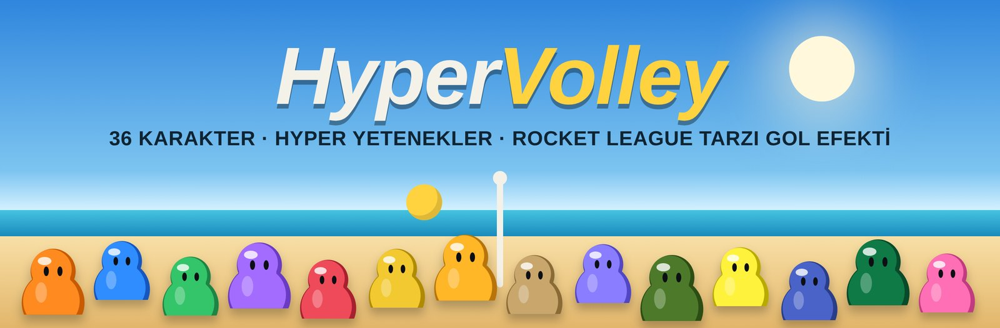
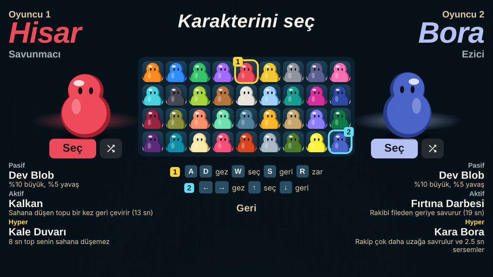
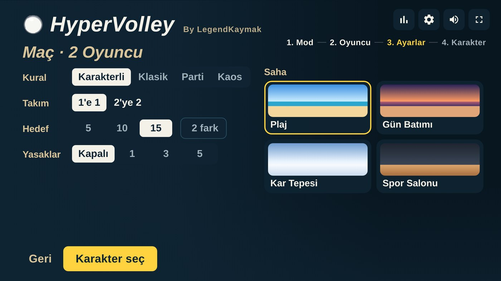
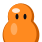
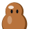
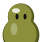
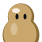
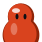

<div align="center">



### Blobby Volley ruhunda, yetenekli ve hızlı 2 kişilik plaj voleybolu

[](https://hypervolley.vercel.app)


**[Oyna](https://hypervolley.vercel.app)** · [Özellikler](#-özellikler) · [Modlar](#-modlar) · [Karakterler](#-karakterler) · [Kontroller](#-kontroller) · [Geliştirme](#-geliştirme)

</div>

---

## ✦ Özellikler

<table>
<tr>
<td width="50%" valign="top">

**🏐 Oyun**
- **36 karakter**, her birinin pasif ve aktif yeteneği ile kendine özgü **Hyper**'ı
- Hyper barı vuruşlarla dolar, bir sonraki aktif yetenekle patlar
- **8 mod**: Maç, HyperMatch, Hayatta kalma, Zamana karşı, Turnuva, Kral sahası, Antrenman, İzle
- 4 zorlukta yapay zeka; **Usta** gerçek fizikle ileriyi simüle edip vuruş planlar
- 1'e 1 ve 2'ye 2, aynı cihazda 2 oyuncu, karakter yasaklama

</td>
<td width="50%" valign="top">

**✨ His ve teknik**
- Her sayıda **Rocket League tarzı patlama**: hit-stop, ağır çekim, şok dalgaları, konfeti, sarsıntı, zoom
- 0.5× **sayı tekrarı** ve vuruş hızı (km/sa)
- 60 Hz sabit adımlı kendi fiziği
- Tüm görseller kodla çizilir, tüm sesler **Web Audio** ile sentezlenir — dış dosya yok
- Klavye, oyun kolu ve **dokunmatik** (iPad / telefon), otomatik grafik kalitesi

</td>
</tr>
</table>

<div align="center">


<br><sub>Dövüş oyunu tarzı karakter seçimi · Adım adım maç ayarları ve 4 saha</sub>
</div>

## 🎮 Modlar

| Mod | Kişi | Açıklama |
|---|:-:|---|
| **Maç** | 1–2 | Yapay zekaya ya da arkadaşına karşı; Karakterli, Klasik, Parti veya Kaos kuralı |
| **HyperMatch** | 1–2 | 15 sayı + 2 fark, iki taraf 5'er karakter yasaklar |
| **Hayatta kalma** | 1 | 5 can, rakip her 3 sayıda güçlenir ve karakter değiştirir |
| **Zamana karşı** | 1–2 | 1 / 2 / 3 dakika; eşitlikte altın sayı |
| **Turnuva** | 2–8 | İsimli oyuncular, eleme ağacı, şampiyon ekranı |
| **Kral sahası** | 3–8 | Kazanan sahada kalır, taçları ilk toplayan kral olur |
| **Antrenman** | 1 | Top makinesi; atış türü ve beklemesiz yetenek seçeneği |
| **İzle** | 0 | İki yapay zekayı izle, kimin kazanacağını tahmin et |

**Kurallar:** Her takımın 3 dokunuş hakkı var, 4. dokunuş hata. Top kumuna düşen taraf sayı verir, servisi sayıyı alan atar. Hedef 5 / 10 / 15, istenirse 2 fark.

<details>
<summary><b>Parti modu kuralları</b></summary>

Her sayıdan önce rastgele biri: Düşük Yerçekimi · Dev Top · Mini Top · Devler · Süper Zıplama · Hızlı Top · Ağır Top · Yetenek Yağmuru · Fırtına · Kaygan Zemin

</details>

## 🧬 Karakterler

Her karakterin **1 pasif**, **1 aktif** yeteneği ve bir **Hyper**'ı var. Hyper barı dolunca "HYPER HAZIR" yazar; bir sonraki aktif kullanımda aktifin üstüne Hyper gelir.

<details>
<summary><b>36 karakterin tamamını göster</b></summary>

| | Karakter | Tarz | Pasif | Aktif | Hyper |
|:-:|---|---|---|---|---|
|  | **Volkan** | Hücumcu | Hızlı Ayaklar | **Güç Vuruşu** · 23 sn<br><sub>Sonraki vuruş %45 güçlü</sub> | **Lav Yağmuru**<br><sub>Sonraki vuruş %45 hızlı, top uzun süre alevle dalar</sub> |
|  | **Tufan** | Kontrolcü | Hızlı Ayaklar | **Yavaş Zaman** · 15 sn<br><sub>Top 1.2 sn yavaşlar</sub> | **Zaman Durdur**<br><sub>Rakip 1.5 sn tamamen donar</sub> |
|  | **Atmaca** | Akrobat | Zıpır | **Hava Atılması** · 9 sn<br><sub>Havada yatay atılma</sub> | **Pike**<br><sub>9 sn çok yüksek zıplar, hızlı koşar</sub> |
|  | **Ametist** | Hilekâr | Hızlı Ayaklar | **Falso** · 8 sn<br><sub>Sonraki vuruşta top havada kıvrılır</sub> | **Büyülü Kıvrım**<br><sub>Sonraki vuruşta top uzun süre sert kıvrılır</sub> |
|  | **Hisar** | Savunmacı | Dev Blob | **Kalkan** · 13 sn<br><sub>Sahana düşen topu bir kez geri çevirir</sub> | **Kale Duvarı**<br><sub>8 sn top senin sahana düşemez</sub> |
|  | **Kehribar** | Pasör | Zıpır | **Mıknatıs** · 9 sn<br><sub>Topu 1 sn sana çeker</sub> | **Süper Mıknatıs**<br><sub>8 sn kendi sahandaki topu sana çeker</sub> |
|  | **Granit** | Bombacı | Sert Vuruş | **Ağır Top** · 14 sn<br><sub>Top 1.5 sn ağırlaşır, hızlı düşer</sub> | **Göktaşı**<br><sub>Sonraki vuruşta top taş gibi ağırlaşıp dalar</sub> |
|  | **Kuzgun** | Ninja | Hızlı Ayaklar | **Işınlanma** · 8 sn<br><sub>Baktığın yöne anında kısa ışınlanma</sub> | **Gölge Adımı**<br><sub>10 sn içinde gelen topun altına kendiliğinden ışınlanır</sub> |
|  | **Meteor** | Uçan | Süzülme | **Roket Zıplama** · 8 sn<br><sub>Yerden anında çok yükseğe zıpla</sub> | **Yıldız Sıçrayışı**<br><sub>9 sn her zıplayış roket gibi</sub> |
|  | **Ayaz** | Duvar | Hızlı Ayaklar | **Kalkan** · 13 sn<br><sub>Sahana düşen topu bir kez geri çevirir</sub> | **Buz Devri**<br><sub>Rakip 4.5 sn yavaşlar, alçak zıplar</sub> |
|  | **Kâbus** | Bozucu | Dev Blob | **Sersemlet** · 15 sn<br><sub>Rakip 1.5 sn yavaş hareket eder</sub> | **Kâbus**<br><sub>Rakibin yönleri 2.2 sn ters döner</sub> |
|  | **Poyraz** | Taktisyen | Zıpır | **Rüzgâr** · 19 sn<br><sub>Top 1 sn rakip sahaya doğru savrulur</sub> | **Kasırga**<br><sub>Sonraki vuruştan sonra top 3 sn rakip sahaya savrulur</sub> |
|  | **Tunç** | Tank | Sert Vuruş | **Şişme** · 16 sn<br><sub>4 sn boyunca %30 büyür</sub> | **Dev Tunç**<br><sub>9 sn kocaman olur, vuruşları sertleşir</sub> |
|  | **Bulut** | Çevik | Hızlı Ayaklar | **Tüy Top** · 14 sn<br><sub>Top 1.6 sn hafifler, yavaş düşer</sub> | **Bulut Yastığı**<br><sub>9 sn kendi sahanda top yavaş düşer</sub> |
|  | **Yıldırım** | Sürat | Zıpır | **Turbo** · 14 sn<br><sub>3 sn boyunca %45 hızlı koşar</sub> | **Işık Hızı**<br><sub>8 sn şimşek gibi koşar</sub> |
|  | **Sis** | Aldatıcı | Süzülme | **Şaşırt** · 24 sn<br><sub>Rakibin sağı solu 0.9 sn ters döner</sub> | **Sis Perdesi**<br><sub>Sonraki vuruşta top rakip sahada 2.5 sn görünmez olur</sub> |
|  | **Cadı** | Büyücü | Süzülme | **Küçült** · 13 sn<br><sub>Rakip 5 sn boyunca küçülür</sub> | **Lanet**<br><sub>Rakip 7 sn küçülür ve yavaşlar</sub> |
|  | **Kâhin** | Okuyucu | Zıpır | **Önsezi** · 10 sn<br><sub>Topun düşeceği yerin altına ışınlanır</sub> | **Kehanet**<br><sub>11 sn sana gelen topun yolunu görür, hızlanır</sub> |
|  | **Ustura** | Keskin | Sert Vuruş | **Kesik Top** · 13 sn<br><sub>Topun yatay hızı kesilir, top dik düşer</sub> | **Keskin Kesim**<br><sub>Sonraki vuruşta top fileyi geçer geçmez dik düşer</sub> |
|  | **Titan** | Dev | Dev Blob | **Deprem** · 17 sn<br><sub>Yerdeki rakip sarsılıp havaya savrulur</sub> | **Yer Sarsıntısı**<br><sub>Rakip havaya savrulur ve sersemler</sub> |
|  | **Nova** | Yıldız | Hızlı Ayaklar | **Kara Delik** · 15 sn<br><sub>Top 1.1 sn rakip sahanın ortasına çekilir</sub> | **Süpernova**<br><sub>Sonraki vuruşta top hızlanır ve arka köşeye çekilir</sub> |
|  | **Yeşim** | Kurtarıcı | Yumuşak Dokunuş | **İkinci Şans** · 18 sn<br><sub>Takımın dokunuş hakkından 1 geri alır</sub> | **Yenilenme**<br><sub>Aktif yetenek hemen dolar, dokunuş hakkı sıfırlanır</sub> |
|  | **Zırh** | Kaleci | Dev Blob | **Ayna** · 23 sn<br><sub>Topun yönünü anında tersine çevirir</sub> | **Ayna Zırh**<br><sub>10 sn içinde sana gelen ilk top geri seker</sub> |
|  | **Zenith** | Efsane | Zirve | **Doruk Atağı** · 11 sn<br><sub>Yükseğe sıçrar, sonraki vuruş %35 güçlü</sub> | **Zirve Formu**<br><sub>9 sn daha hızlı, daha yüksek, daha sert</sub> |
|  | **Pars** | Avcı | Çift Zıplama | **Yakala** · 18 sn<br><sub>Sonraki topu yakalar, 0.4 sn sonra rakibe fırlatır</sub> | **Av Pençesi**<br><sub>9 sn her topu yakalar, %25 daha sert fırlatır</sub> |
|  | **Phantom** | İllüzyonist | Süzülme | **Hayal Top** · 22 sn<br><sub>Gerçeğinden ayırt edilemeyen sahte bir top başka yöne uçar</sub> | **Aynalar Salonu**<br><sub>Topun yanında 3 sahte top birden uçar</sub> |
|  | **Ejder** | Yıkıcı | Sert Vuruş | **Ejder Nefesi** · 23 sn<br><sub>Yakındaki topu ateşle rakip sahaya üfler (uzanamadığın topu kurtarır)</sub> | **Alev Fırtınası**<br><sub>Üflenen top alevle dalar, rakip 2 sn sersemler</sub> |
|  | **Akrep** | Zehirli | Zıpır | **Uyuştur** · 24 sn<br><sub>Rakibin vuruşları 2.5 sn %11 zayıflar</sub> | **Zehir**<br><sub>Rakibin vuruşları 9 sn zayıflar, 2.5 sn yavaşlar</sub> |
|  | **Atlas** | Taşıyıcı | Hızlı Ayaklar | **Gök Askısı** · 14 sn<br><sub>Top 1 sn havada asılı kalır (yetişemediğin topa zaman kazandırır)</sub> | **Gök Kilidi**<br><sub>Top 1.6 sn asılı kalır, rakip 1 sn donar</sub> |
|  | **Cura** | Şifacı | Sert Vuruş | **Kutsama** · 13 sn<br><sub>5 sn hızlanır, yükseğe zıplar, sert vurur; olumsuz etki almaz</sub> | **Kutsal Alan**<br><sub>8 sn takımın olumsuz etki almaz, hızlanır; dokunuş hakkı yenilenir</sub> |
|  | **Diva** | Solist | Hızlı Ayaklar | **Yüksek Nota** · 14 sn<br><sub>Ses dalgası kendi sahandaki yakın topu dikine havaya kaldırır (düşen topu kurtarır)</sub> | **Final Sahnesi**<br><sub>9 sn daha yükseğe zıplar, daha sert vurur</sub> |
|  | **Kor** | Kızgın | Sert Vuruş | **Kor Top** · 16 sn<br><sub>Top 4 sn kızar: rakibin ilk dokunuşu 2 dokunuş sayılır</sub> | **Kızgın Top**<br><sub>6 sn rakibin HER dokunuşu 2 dokunuş sayılır</sub> |
|  | **Mızrak** | Nişancı | Zıpır | **Hat Vuruşu** · 13 sn<br><sub>Sonraki vuruş kısa süre yerçekimsiz, dümdüz gider</sub> | **Yıldırım Mızrağı**<br><sub>Sonraki vuruş daha uzun süre dümdüz ve %20 hızlı gider</sub> |
|  | **Diken** | Köklü | Dev Blob | **Kök Sal** · 15 sn<br><sub>Rakip 2.5 sn zıplayamaz</sub> | **Derin Kök**<br><sub>Rakip 5 sn zıplayamaz ve 2 sn yavaşlar</sub> |
|  | **Kıvılcım** | Sabotajcı | Hızlı Ayaklar | **Kısa Devre** · 18 sn<br><sub>Rakibin aktif yeteneği baştan beklemeye girer, Hyper barı %35 azalır</sub> | **Karartma**<br><sub>Rakibin Hyper barı sıfırlanır, 2 sn sersemler</sub> |
|  | **Bora** | Ezici | Dev Blob | **Fırtına Darbesi** · 19 sn<br><sub>Rakibi fileden geriye savurur</sub> | **Kara Bora**<br><sub>Rakip çok daha uzağa savrulur ve 2.5 sn sersemler</sub> |

**Pasifler:** Zıpır (%12 yüksek zıplama) · Hızlı Ayaklar (%10 hızlı) · Dev Blob (%10 büyük, %5 yavaş) · Sert Vuruş (%6 güçlü) · Süzülme (yavaş iniş) · Yumuşak Dokunuş (sert topu yavaşlatır) · Çift Zıplama · Zirve (Zenith'e özel)

</details>

## ⌨️ Kontroller

| | Hareket | Zıpla | Yetenek |
|---|:-:|:-:|:-:|
| **Oyuncu 1** | `A` `D` | `W` | `S` / `Q` |
| **Oyuncu 2** | `←` `→` | `↑` | `↓` / `Sağ Shift` / `Enter` |
| **Oyun kolu** | Sol çubuk | `A` | `X` / `B` |

`Esc` duraklat · `M` ses · `Boşluk` tekrarı atla · Tuşlar **Ayarlar → Kontroller**'den değiştirilebilir.
Dokunmatik cihazlarda ekran butonları otomatik çıkar; boyut ve saydamlık ayarlanabilir. Ana ekrana eklenince çevrimdışı da çalışır (PWA).

## 🛠 Geliştirme

```bash
npm install
npm run dev       # geliştirme sunucusu
npm run build     # dist/ klasörüne statik çıktı
npm run preview   # build çıktısını yerelde dene
```

`main` dalına her gönderim [Vercel](https://hypervolley.vercel.app)'de otomatik yayınlanır. `vite.config.js` içinde `base: './'` olduğu için Netlify ve GitHub Pages alt klasörlerinde de çalışır.

<details>
<summary><b>Proje yapısı</b></summary>

```
src/
├─ main.js            Pixi kurulumu, ölçekleme, durum makinesi, 60 Hz sabit adımlı döngü
├─ config.js          tüm sabitler ve balans değerleri (tek yerde)
├─ game/              oyun mantığı — Pixi'den bağımsız, Node'da test edilebilir
│  ├─ world.js        bir fizik adımında her şeyi ilerleten çekirdek
│  ├─ physics.js      blob, top, file ve duvar çarpışmaları
│  ├─ rules.js        3 dokunuş, sayı, servis, seri, hedef
│  ├─ abilities.js    veri odaklı yetenekler
│  ├─ hyper.js        36 Hyper
│  ├─ characters.js   karakter listesi
│  ├─ ai.js           yapay zeka ve Usta planlayıcısı
│  └─ tournament.js · kingcourt.js · mods.js · replay.js · stats.js · timeScale.js
├─ render/            stage, HUD, gol patlaması, parçacıklar, tween
├─ audio/sfx.js       Web Audio ses sentezi
├─ input/             klavye, dokunmatik, oyun kolu
├─ ui/                DOM menüleri ve Material Symbols ikonları
└─ i18n.js · lang/en.js
```

Balans, fizik, efekt ve yapay zeka ayarlarının hepsi `src/config.js` içinde.

</details>

<div align="center">
<br>
<sub>Made by <b>LegendKaymak</b></sub>
</div>
